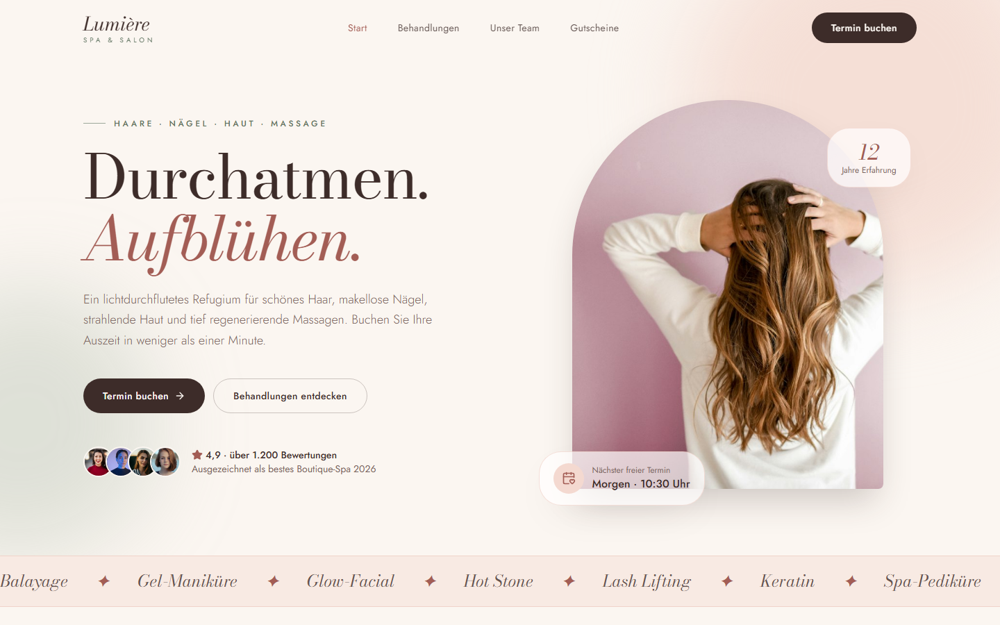

# Lumière Spa & Salon: demo website

**Live-Demo:** https://PHosseini03.github.io/beauty-spa/ · **Alle Demos:** https://PHosseini03.github.io/website-showcase/

An airy, elegant website for a boutique beauty salon and spa: blush, sage and cream, Bodoni Moda italic accents, arch-shaped photo frames. React + TypeScript frontend and a FastAPI backend.

**Language:** the whole site is in German (formal „Sie“), with prices in euros (`de-DE` formatting), German dates and 24-hour times, and placeholder contact details (“Ihre Adresse hier”, “Ihre Telefonnummer hier”). API error messages are German too; field names and routes stay in English.

## Features
- Hero with floating "next available" card, scrolling treatment marquee, category arches
- **Service menu** by category (hair, nails, skin, massage) with prices and durations from the API
- **4-step booking wizard**: treatment, specialist (only those who offer it), day and live time slots, details. Confirmation screen.
- Real-time availability that respects opening hours (closed Mondays) and blocks double-booking (HTTP 409)
- Curated packages, team profiles, testimonials, Instagram-style gallery
- **Gift cards** with live card preview, preset or custom amount, email or print delivery
- Fully responsive (360px to 1440px+), keyboard accessible, respects reduced-motion; works offline with demo data

## Run it
| Part | Port | Command (from this folder) |
|---|---|---|
| API | 8007 | `cd backend; python -m venv .venv; .venv\Scripts\pip install -r requirements.txt; .venv\Scripts\python -m uvicorn app.main:app --port 8007` |
| Web | 5177 | `cd frontend; npm install; npm run dev` |

Open http://localhost:5177. API docs: http://localhost:8007/docs.

## Pages
`/` · `/services` (supports `?category=nails`) · `/team` · `/book` (supports `?service=7&staff=4`) · `/gift-cards` · 404

## API
| Method | Path | Purpose |
|---|---|---|
| GET | `/api/health` | Health check |
| GET | `/api/services?category=` | Service menu |
| GET | `/api/staff` | Team members and specialties |
| GET | `/api/packages` | Packages |
| GET | `/api/testimonials` | Reviews |
| GET | `/api/hours` | Opening hours |
| GET | `/api/availability?staff_id=&service_id=&date=` | Free start times |
| POST | `/api/appointments` | Book (10/min; 404 unknown service/staff, 422 invalid/closed, 409 slot taken) |
| POST | `/api/gift-cards` | Gift card request (10/min; 25 € to 1,000 € in steps of 5) |

All responses use `{ "success": bool, "data": ..., "error": string | null }`.

## Quality
- Backend: `pip install -r requirements-dev.txt; pytest --cov=app` (23 tests, 98% coverage)
- Frontend: `npm test` (19 tests, 93% statements), `npm run lint`, `npm run build`
- Security: strict Pydantic schemas (extra fields rejected), parameterized SQL, booking lock against races, rate limiting, body-size limit, CORS allow-list, security headers, no secrets in code. `bandit` and `pip-audit` clean.

*Demo only. The business, people and reviews are fictional. Photos: Unsplash (free licence).*
